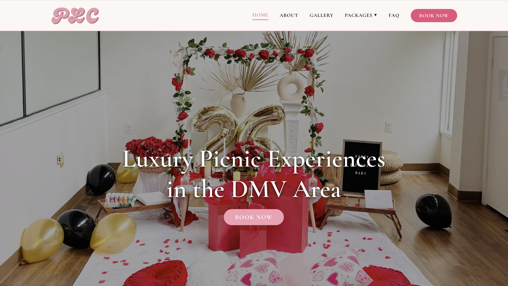
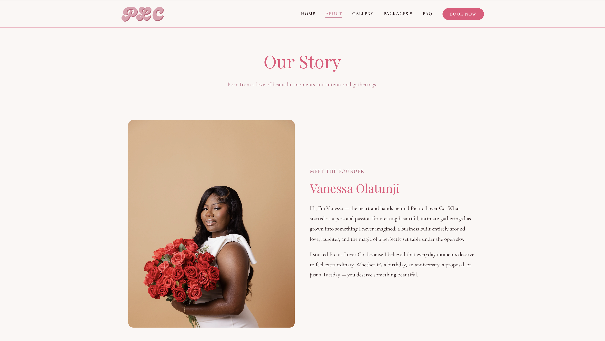
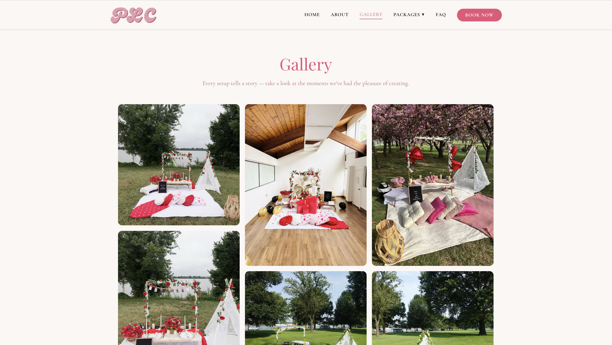
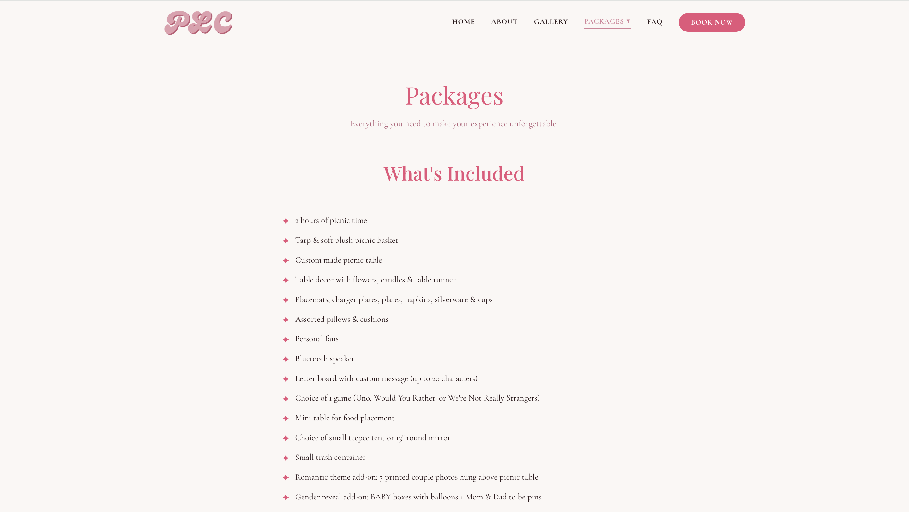
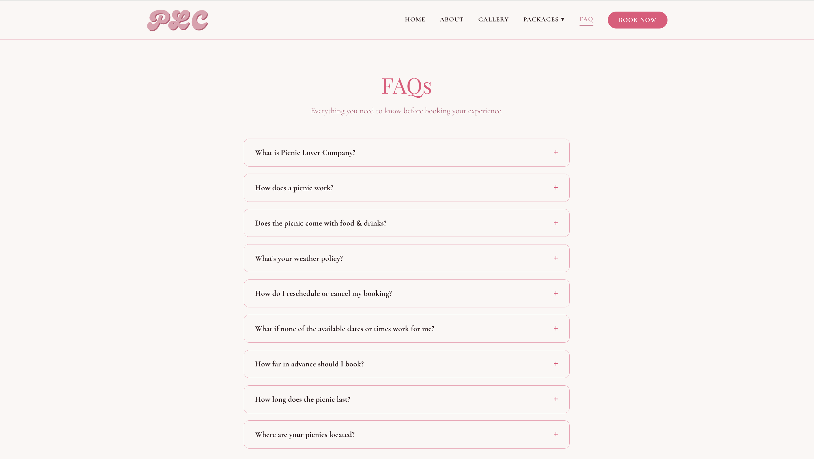
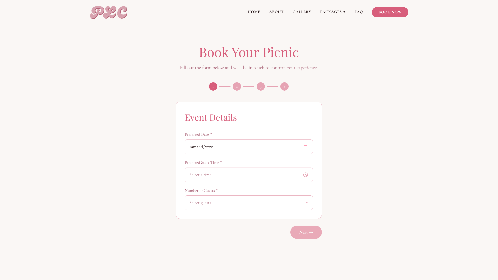

# Picnic Lover Company

A full-stack business website built for [Picnic Lover Co.](https://picnicloverco.com) — a luxury picnic experience company based in the DMV area. The site replaces a manual Instagram DM / text message booking process with a structured, automated system complete with a multi-step booking form, transactional emails, and a protected admin dashboard.

**Live site:** [picnicloverco.com](https://picnicloverco.com)

---

## Screenshots

### Homepage


### About


### Gallery


### Packages


### FAQ


### Booking Form


---

## Tech Stack

| Layer | Technology |
|---|---|
| Frontend | Next.js 16 (App Router), TypeScript, Tailwind CSS, Framer Motion |
| API | Next.js Route Handlers (serverless, hosted on Vercel) |
| Database | PostgreSQL via [Neon](https://neon.tech) (serverless) |
| ORM | Prisma |
| Email | AWS SES |
| Auth | JWT |
| Deployment | Vercel |
| Domain | Namecheap → picnicloverco.com |

---

## Features

- **Multi-step booking form** — 4-step form with client-side validation collecting date, time, guests, theme, location, add-ons, and contact info
- **Automated emails** — AWS SES sends a booking confirmation to the customer and a real-time alert to the business owner on every submission
- **Admin dashboard** — JWT-protected dashboard for the owner to view all reservations, customer details, and update booking statuses (Pending / Confirmed / Cancelled)
- **Gallery** — Lightbox photo gallery showcasing past picnic setups
- **Packages page** — Pricing, add-ons, deposit policy, preferred locations, and themes with color swatches
- **FAQ page** — Accordion-style FAQ section
- **Fully responsive** — Optimized for mobile and desktop

---

## Local Development

### Prerequisites
- Node.js 18+
- A PostgreSQL database (e.g. [Neon](https://neon.tech) free tier)
- AWS SES credentials with a verified sender email

### Setup

1. Clone the repo:
```bash
git clone https://github.com/DavidOlatunji18/picnic-lover.git
cd picnic-lover/frontend
```

2. Install dependencies:
```bash
npm install
```

3. Create a `.env.local` file in the `frontend` directory:
```env
DATABASE_URL=your_postgresql_connection_string

JWT_SECRET=your_jwt_secret
ADMIN_EMAIL=your_admin_email
ADMIN_PASSWORD=your_admin_password

AWS_ACCESS_KEY_ID=your_aws_access_key
AWS_SECRET_ACCESS_KEY=your_aws_secret_key
AWS_REGION=your_aws_region
SENDER_EMAIL=hello@picnicloverco.com
OWNER_EMAIL=your_owner_email
```

4. Run database migrations:
```bash
npx prisma migrate deploy
```

5. Start the development server:
```bash
npm run dev
```

Open [http://localhost:3000](http://localhost:3000) to view the site.

---

## Project Structure

```
frontend/
├── app/
│   ├── api/
│   │   ├── auth/login/     # POST — admin login
│   │   └── bookings/       # POST (create), GET (admin list)
│   │       └── [id]/       # PATCH — update booking status
│   ├── about/
│   ├── book/
│   ├── dashboard/
│   ├── faq/
│   ├── gallery/
│   ├── packages/
│   └── components/
├── lib/
│   ├── prisma.ts           # Prisma client singleton
│   └── email.ts            # AWS SES email helpers
└── prisma/
    └── schema.prisma
```

---

## Deployment

The app is deployed on **Vercel** with automatic deployments on every push to `main`. Environment variables are configured in the Vercel project settings.
